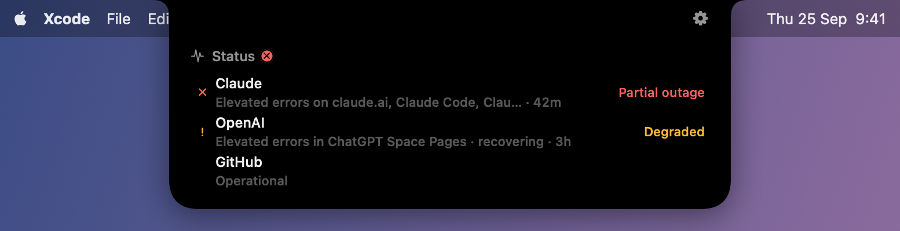

# Status Pages for Blipbar

A [Blipbar](https://blipbar.app) extension that shows in the notch when a service you depend
on has an incident. It reads the status pages of Claude, OpenAI, GitHub, Cloudflare, Vercel
and other pages made with Atlassian Statuspage or incident.io. It needs no key or account.



## Install

In Blipbar, open Settings › Blips › Browse…, find Status Pages and press Install. You can
also download the `.blipbar` file from the
[latest release](https://github.com/blipbar/status-pages/releases/latest) and open it.

Blipbar adds it to the panel. To have it appear beside the camera only when something is
wrong, choose Edit Layout… from the notch's right-click menu, drag Status into an ear, and
set it to "Only alerts".

## What it shows

Status is one list with a row for each page. A page with an open incident moves to the top:
red for a partial or major outage, amber when the service is degraded. The row has the
incident's title from the page and how long it has been open, and clicking it opens the
incident on the status page.

An ear set to "Only alerts" stays empty until a page has an incident, then shows the
service's name until you open the notch. When an incident that alerted is resolved, its row
turns green for ten minutes and then goes back to "Operational".

## Settings

**Status pages** takes one address per line, with its `https://`. It starts with Claude,
OpenAI and GitHub. To watch only part of a page, put the component names after the address,
spelled the way the page spells them, with commas between:

```
https://status.claude.com Claude Code, Claude API
https://www.githubstatus.com Actions
```

An exact name matches that component only. Otherwise a name matches every component that
starts with it, so "Claude API" finds "Claude API (api.anthropic.com)". A name the page
doesn't have shows as a red row that starts listing the names it does have.

**Alert for** is "Any incident" or "Outages only". With "Outages only", a degraded service
still shows in the list, but it doesn't turn Status amber or show in an "Only alerts" ear.

## Which pages work

To check a page, add `/api/v2/status.json` to its address and open it. If you see JSON, it
works. Stripe, Slack, AWS and Google Cloud run status pages of their own, which this can't
read. Adding one shows a red row that says so.

If a page has moved to a new address (status.anthropic.com now redirects to
status.claude.com), its row tells you the address to use instead.

## What it sends

It only contacts the status pages you list, and all it asks them for is their status. It
sends nothing to anyone else. Every two minutes (every minute while a row is red or amber) it
asks each page for its current status, which is about 200 bytes. Only when a page has changed
since the last look does it fetch more from that page: its open incidents, and its
components if you watch parts of it.

## Build it yourself

```sh
npm install
npm test              # unit tests, run against status pages captured in fixtures/
npx blipkit validate  # one run against the real pages, printed
npx blipkit dev       # builds on save and links it into Blipbar
npx blipkit pack      # makes status-pages-<version>.blipbar
```

`src/statuspage.ts` reads the API, `src/pages.ts` reads the setting, `src/report.ts` decides
what each row says, and `src/index.ts` fetches and runs. Bugs and ideas go in
[issues](https://github.com/blipbar/status-pages/issues). The guide to building Blipbar
extensions is at https://blipbar.app/docs/.

## License

MIT
